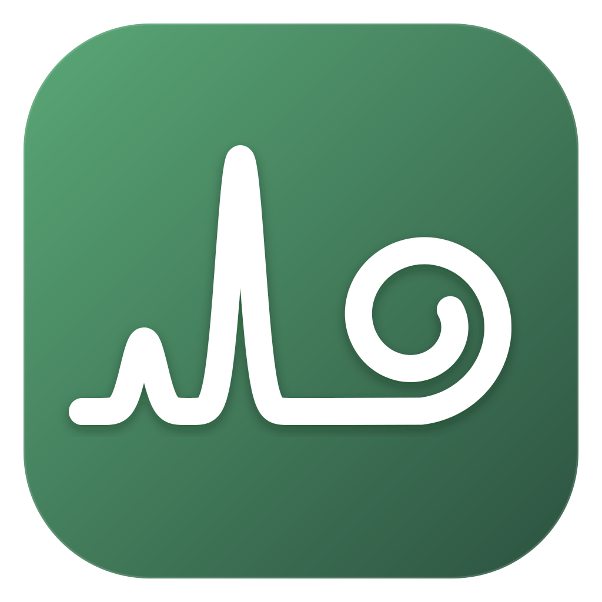
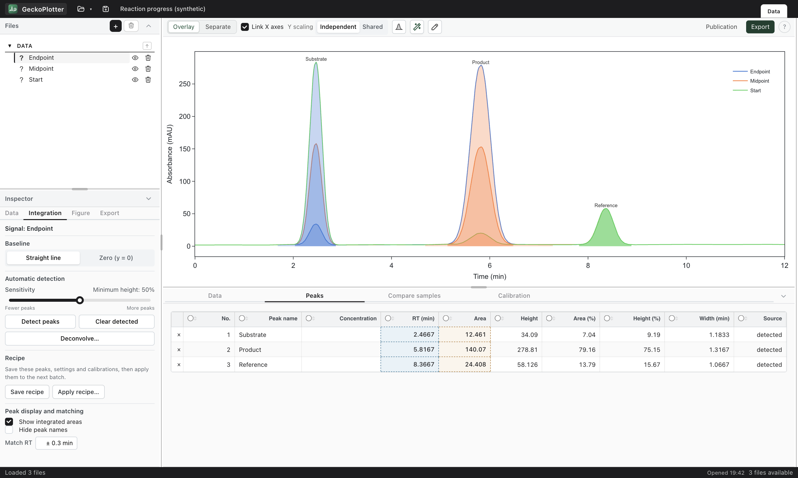
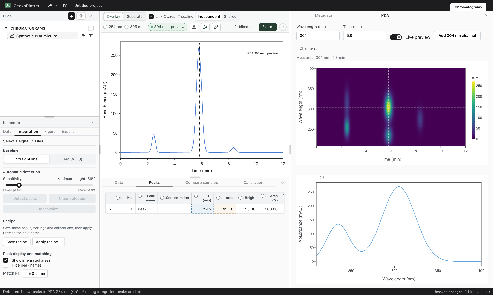
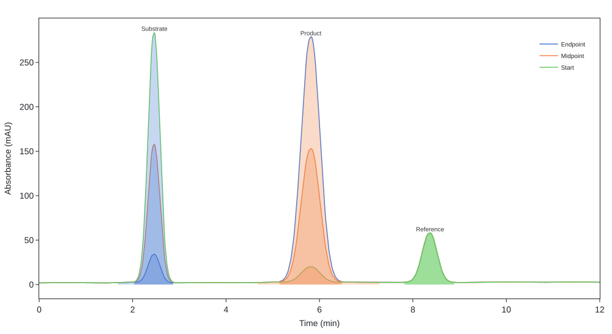

<p align="center">
  
</p>

<h1 align="center">GeckoPlotter</h1>

<p align="center"><strong>Explore instrument data, integrate peaks, and build figures you can keep editing.</strong></p>

<p align="center">
  <a href="#get-started">Get started</a> ·
  <a href="#try-the-examples">Try the examples</a> ·
  <a href="#supported-formats">Supported formats</a> ·
  <a href="docs/AGENT.md">Agent interface</a> ·
  <a href="#from-anyplot-to-geckoplotter">Project history</a>
</p>



*Compare samples in one workspace, inspect peak areas, and adjust the analysis directly on the plot. The screenshots use the downloadable synthetic examples below.*

GeckoPlotter is a scientific data workstation that runs on your computer and opens in your browser. It brings HPLC, LC-MS, PDA, UV-Vis, and kinetics data into a shared workspace, from the original instrument files through integration, calibration, and figure export. Save the whole analysis as a `.gecko` project, or prepare a FAIR-data package containing the sources, results, processing history, and figures.

Built by [Glenn Bojanov](https://github.com/glebo309) for day-to-day laboratory work. This is the third generation of the project, rebuilt with Dash and Plotly after [AnyPlot](https://github.com/glebo309/anyplot-archive) and [GeckoPlotter for Streamlit](https://github.com/glebo309/geckoplotter-streamlit). Development is active.

## Work with your data

- **Compare runs.** Overlay traces or give them separate panes. Group related files, switch detector channels, link time axes, and control visibility from the file tree or legend.
- **Integrate and identify peaks.** Detect automatically, draw a baseline, adjust an integration, rename a compound, or deconvolve overlapping peaks. Compare matching peaks across samples and fit calibration curves.
- **Explore PDA and LC-MS.** Move through the time/wavelength matrix, preview a chromatogram at another wavelength, inspect UV spectra, extract ion chromatograms, and read mass spectra at a time point or over a peak.
- **Make the figure.** Edit axes, colours, line styles, legends, and labels. Create a separate publication copy and export SVG, PDF, PNG, or TIFF at the chosen physical size and resolution.
- **Continue tomorrow.** Save and reopen `.gecko` projects with sources, integrations, calibrations, and display settings. Autosave offers recovery; reusable recipes carry integration settings, named retention windows, and calibrations into another batch.
- **Keep the analysis with the result.** Export original files, open tables, peak results, metadata, processing history, figures, and a readable report together in a FAIR-data ZIP.

### Inspect the full PDA measurement



*Select a point in the heatmap to inspect its spectrum and chromatogram. Add a wavelength as a channel when you want to keep working with it.*

Shimadzu LabSolutions `.lcd` files open directly with their PDA matrix, recorded channels, sample metadata, instrument status traces, and embedded method. Sectioned ASCII exports are supported too. Separate `.lcm` method files attach to matching samples, so method details stay with the analysis. See the [LCD reader notes](docs/LCD_FORMAT_NOTES.md) for the verified scope.

## Get started

### Download the launcher

**[Download GeckoPlotter Launcher](https://github.com/glebo309/GeckoPlotter/raw/main/deploy/launcher/GeckoPlotter-Launcher.zip)**

Unzip it, then open the start file for your system:

| System | Start file |
| --- | --- |
| Windows | `start-windows.bat` |
| macOS | `start-mac.command` |
| Linux | `bash start-linux.sh` |

The first start downloads a private Python environment and dependencies, about 600 MB. Later starts check for updates and open the app in your browser. No system-wide Python installation or administrator rights are needed. The launcher creates a GeckoPlotter shortcut for subsequent starts.

See [launcher instructions](deploy/launcher/README.txt) for first-run opening prompts and log locations.

### Run from source

```bash
git clone https://github.com/glebo309/GeckoPlotter.git
cd GeckoPlotter
python3 -m venv .venv
source .venv/bin/activate
pip install -r requirements.txt
python app.py
```

On Windows, activate the environment with `.venv\Scripts\activate` instead. Open **http://127.0.0.1:8052** and drop your files into the workspace.

Static figure export uses Kaleido and requires a compatible Chrome installation.

### Try the examples

Start with the [example guide](docs/examples/README.md). All included data are synthetic and can be shared freely.

1. Open [reaction-progress.gecko](docs/examples/reaction-progress.gecko) for three named samples with integrated peaks, ready to inspect. Or import the [three CSV files](docs/examples/) to try the analysis yourself.
2. Import [synthetic_pda.txt](docs/examples/synthetic_pda.txt), then open **PDA** in the right panel. Move through the heatmap, inspect the spectrum, and add a wavelength channel.
3. Use **Publication** to make a figure copy, or **Export** to save a figure or FAIR-data package. Save your workspace as a `.gecko` project to reopen it later.

## Supported formats

Support follows the contents and export layout, not just the filename extension. The table describes the implemented readers; a new instrument variant may need an adapter.

| Format | Instrument / source | Extension | What is read |
| --- | --- | --- | --- |
| LabSolutions raw PDA data | Shimadzu LC/PDA | `.lcd` | PDA matrix, recorded wavelength channels, sample metadata, status traces, and embedded method |
| LabSolutions sectioned ASCII | Shimadzu LC/PDA | `.txt`, `.asc` | Chromatograms, PDA matrix when present, sample metadata, exported peak tables, and status traces |
| LabSolutions instrument method | Shimadzu | `.lcm` | Method metadata attached to matching samples, including gradient, flow, and oven settings |
| Chromeleon chromatogram | Thermo Chromeleon HPLC | `.txt` | Chromatogram and supported exported metadata/peaks |
| LC-MS netCDF | Agilent / compatible ANDI-MS exports | `.cdf` | TIC and scan-level mass spectra where present |
| VWD netCDF | Agilent UV detector exports | `.cdf` | UV chromatogram and detector metadata |
| OpenLAB trace CSV | Agilent `.dx_…` TIC / VWD exports | `.csv` | Exported TIC or UV trace; CSV traces alone do not contain full mass spectra |
| Wavelength-by-well CSV | Plate-reader spectral exports | `.csv` | Wavelength axis and well spectra |
| Cary kinetics | Agilent Cary 300/3500 exports | `.csv` | Time-series absorbance and supported metadata |
| Excel workbook | Tabular data | `.xlsx`, `.xls` | Usable sheets with inferred X/Y columns; legacy `.xls` needs an installed pandas-compatible reader such as `xlrd` |
| Delimited text | Generic X/Y data | `.csv`, `.txt`, `.tsv` | Tabular data through the generic detector |
| GeckoPlotter project | Saved workspace | `.gecko` | Source data, analysis, calibration, and workspace state |
| GeckoPlotter FAIR-data package | Exported research package | `.zip` | Reopens the included project when present |
| Analysis recipe | Saved GeckoPlotter recipe | `.geckorecipe` | Integration settings, compound windows, and calibration models |

Shimadzu `.lcb` batch files are not currently supported. The `.lcd` reader does not yet import LabSolutions' own processed peak tables or its LC-MS data. See [adding instrument formats](docs/ADDING_FORMATS.md) for the adapter contract and validation workflow.

## Figures and research packages



*The figure and the editable workspace come from the same analysis.*

Figure export supports **SVG, PDF, PNG, and TIFF**, with physical dimensions and resolution controls. You can export the current view or work on a publication copy with its own styling.

**Export → FAIR-data package** collects the analysis into one ZIP:

- Original uploaded files and untouched parsed data.
- Current tables and the exact source values used in the displayed figure.
- Peak results, calibration models, metadata, and timestamped processing history.
- Selected figure formats, checksums, a README, and an HTML report.
- A reopenable `.gecko` project when it can be included, plus optional figure-regeneration code.

Repository details let you add authors, identifiers, methods, funding, and licensing. Export prepares a local package; it does not deposit it in a repository or certify compliance. [Research export details](docs/RESEARCH_EXPORT.md)

## Use from an agent or Python

The local **MCP interface** lets an agent open data, inspect samples, integrate peaks, extract ion chromatograms, read mass spectra, make a figure, and save a project. The result opens in GeckoPlotter for visual review and manual editing.

The agent works in its own workspace and hands the analysis over through a saved project. It does not control an already-open browser workspace. The same operations are available through the Python `Workspace` API for scripts and notebooks. [Setup, tools, and current limits](docs/AGENT.md)

## Everyday controls

| Action | Control |
| --- | --- |
| Zoom into a region | Drag on the plot |
| Reset the view | Double-click |
| Pan | Ctrl/Cmd-drag |
| Integrate a peak | Shift-drag, or enable Integrate |
| Edit an integration or figure element | Right-click for its menu |
| Undo / redo | Ctrl/Cmd+Z / Ctrl/Cmd+Shift+Z |
| Save / open a project | Ctrl/Cmd+S / Ctrl/Cmd+O |
| Deselect or leave an editing mode | Escape |

## Run a shared copy

A running server gives each browser its own workspace, including files, peaks, and autosaves. Data parsing and calculations run on the host computer. For heavy data, running your own local copy avoids sharing the server's resources.

| Setting | Purpose |
| --- | --- |
| `GECKO_PORT` | HTTP port, default `8052` |
| `GECKO_HOST` | Bind address, default `127.0.0.1`; use `0.0.0.0` for local-network access |
| `GECKO_SLOW_MS` | Log slow callbacks, default `500` ms |
| `GECKO_DEBUG=1` | Enable the development debugger |

Idle in-memory workspaces expire after eight hours; autosaves stay on disk. The registry keeps at most 12 in-memory workspaces. Deployment notes: [Windows](deploy/windows/README.md), [Linux](deploy/linux/README.md).

## From AnyPlot to GeckoPlotter

This project has grown through three generations:

| Generation | Project | Milestone |
| --- | --- | --- |
| 1 | **[AnyPlot](https://github.com/glebo309/anyplot-archive)** | The first major milestone: a desktop HPLC viewer built with tkinter and Matplotlib, with overlays, peak integration, annotations, and figure export. |
| 2 | **[GeckoPlotter for Streamlit](https://github.com/glebo309/geckoplotter-streamlit)** | The browser-based predecessor, expanding into LC-MS, calibration, and scientific analysis. |
| 3 | **GeckoPlotter, this repository** | A Dash/Plotly workstation with linked detector views, editable analysis, persistent projects, publication figures, research packages, and an agent interface. |

Both predecessors are archived. Older documentation and local folders may call the Dash application “V2”; counting AnyPlot, it is the third generation. The application is now substantially broader than the original chromatogram viewer.

## Development

```bash
pytest tests/ -q
node --test tests/js/*.test.cjs
python -c "import app"
```

The active application is `app.py`. Code lives in `src/`, with callbacks, UI components, shared services, and instrument-specific ingestion presets. Archived implementations are under `archive/`.

Read the latest review in [ROADMAP.md](ROADMAP.md) for current work. The older sections are historical. Useful implementation references:

- [Instrument format adapters](docs/ADDING_FORMATS.md)
- [Projects and session format](docs/SESSION_FORMAT.md)
- [Reusable analysis recipes](docs/RECIPES.md)
- [Research package contents](docs/RESEARCH_EXPORT.md)
- [MCP and Python interface](docs/AGENT.md)
